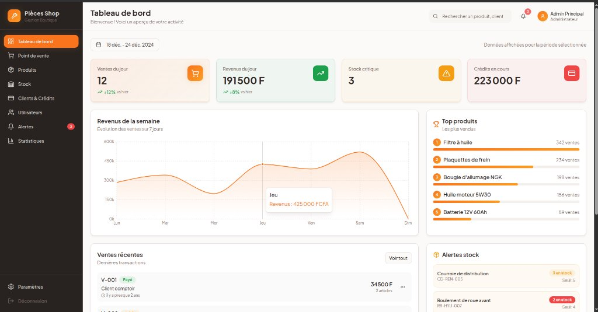
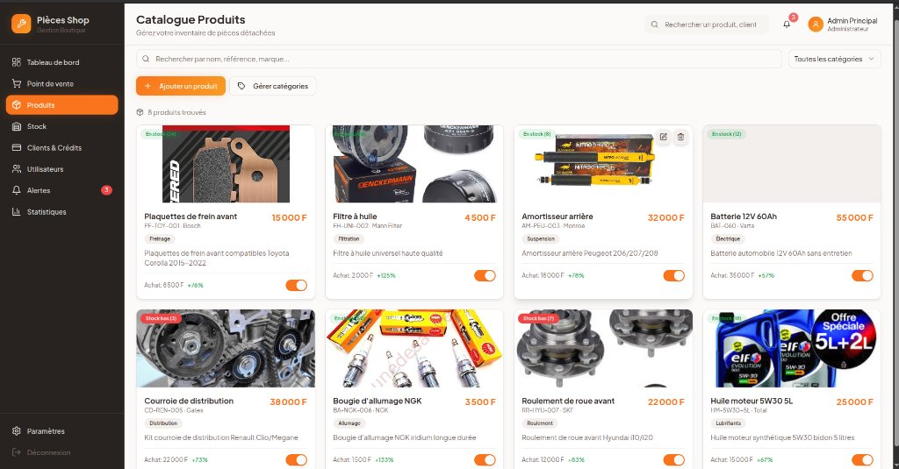
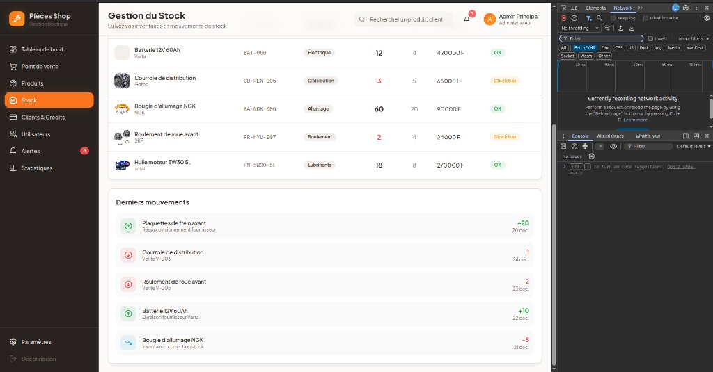
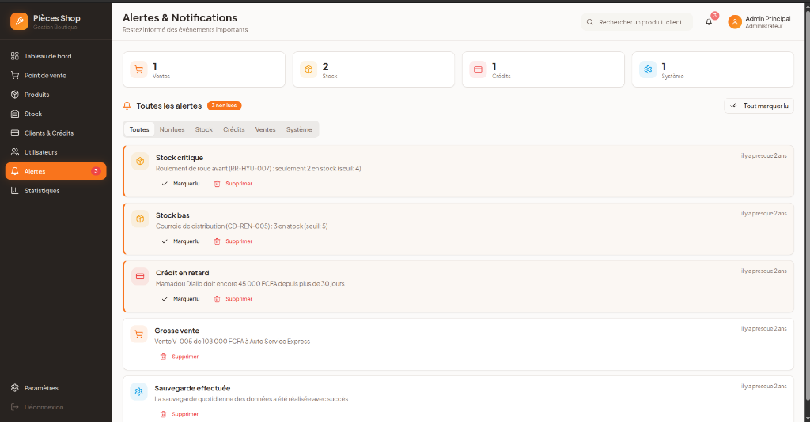
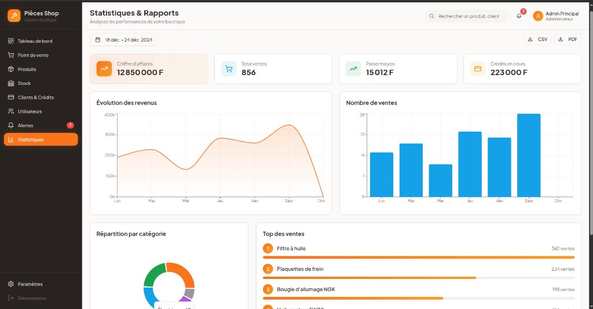
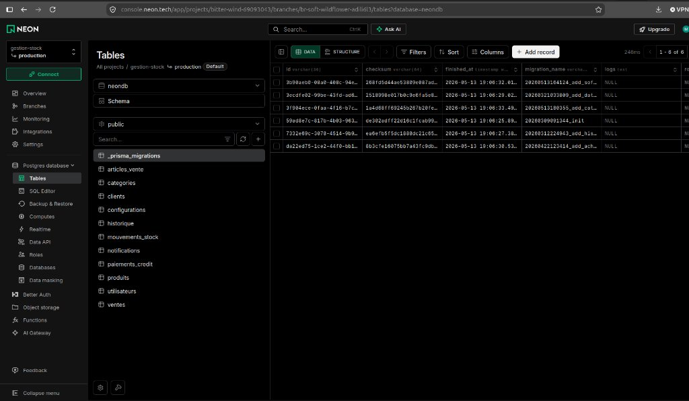

# Pieces Shop - Application Frontend de Gestion de Stock, Ventes et Point de Vente (POS)

Application web complete, moderne et responsive de gestion commerciale, concue pour le pilotage d'inventaire de pieces detachees, la facturation en point de vente (POS), le recouvrement des creances clients et l'analyse financiere en temps reel.

L'interface propose une experience utilisateur soignee, avec un theme sombre professionnel enrichi de touches orange, une reactivite instantanee et un suivi rigoureux des donnees commerciales libellees en Francs CFA (FCFA).



## Apercu Visuel de la Plateforme











## Fonctionnalites Principales

### 1. Tableau de Bord Executif
- Indicateurs cles d'activite (KPIs) : nombre de ventes du jour, chiffre d'affaires quotidien (FCFA), articles en stock critique et montant total des credits en cours.
- Courbe d'evolution hebdomadaire des revenus avec tooltips interactifs.
- Classement des produits les plus vendus (filtres a huile, plaquettes de frein, bougies d'allumage, batteries).
- Flux des transactions recentes et alertes immediates sur les seuils d'inventaire bas.

### 2. Point de Vente (POS) et Facturation
- Terminal de caisse rapide adapte aux ventes au comptoir.
- Recherche instantanee d'articles par reference, designation ou marque.
- Prise en charge des differents modes de reglement : especes, mobile money, carte bancaire et vente a credit.
- Association directe de la transaction a un client debiteur ou a un acheteur de passage (nom, prenom, telephone).
- Generation automatique des recus imprimables et telechargeables au format PDF.

### 3. Catalogue Produits et Suivi des Marges
- Grille responsive de cartes d'articles avec photographies reelles et badges d'etat (En stock, Stock bas).
- Fiches tarifaires detaillees affichant le prix d'achat fournisseur, le taux de marge commerciale en pourcentage et le prix de vente public.
- Interrupteur d'activation / desactivation immediate de la disponibilite en boutique.
- Filtrage avance par categorie de pieces (Freinage, Filtration, Suspension, Electrique, Distribution, Allumage, Lubrifiants).

### 4. Controle d'Inventaire et Tracabilite des Stocks
- Tableau de bord exhaustif du niveau de stock par article compare a son seuil minimal d'alerte.
- Estimation globale de la valorisation financiere du stock magasin.
- Journal d'audit des derniers mouvements tracant precisement les reapprovisionnements fournisseurs (+), les sorties de ventes (-) et les ajustements d'inventaire manuels.

### 5. Recouvrement des Creances et Echeances
- Suivi individualise des dettes clients avec date limite de paiement.
- Identification automatique des creances en souffrance (dettes superieures a 30 jours).
- Interface dediee a l'enregistrement des paiements partiels et a la reduction progressive du solde restant.

### 6. Alertes et Notifications Intelligentes
- Centre de notification centralise avec filtres par typologie (Ventes, Stock, Credits, Systeme).
- Declenchement automatique d'alertes des qu'un seuil critique est atteint ou qu'un credit arrive a echeance.
- Actions rapides d'acquittement : marquer comme lu ou supprimer la notification.

### 7. Statistiques et Rapports Decisionnels
- Visualisation graphique des revenus et des volumes de ventes journaliers par histogrammes et courbes.
- Graphique circulaire de repartition des ventes par categorie d'articles.
- Exportation des rapports de gestion aux formats CSV et PDF pour la comptabilite.

## Architecture Technique Frontend

- Framework applicatif : React 18 avec TypeScript garantissant un typage statique rigoureux de l'ensemble des modeles de donnees.
- Outil de build : Vite pour une compilation ultra-rapide et un rechargement a chaud instantane.
- Design System et Stylisation : Tailwind CSS combine aux composants modulaires accessibles de Radix UI.
- Visualisation de donnees : Recharts pour les graphiques statistiques dynamiques et responsives.
- Communication API : Axios centralise au sein d'un contexte React global (AppContext) assurant la synchronisation fluide avec l'API RESTful.
- Gestion du routage : React Router DOM 6 avec protection des routes selon les roles (Admin vs Vendeur).
- Typographie et Iconographie : Plus Jakarta Sans et icones vectorielles Lucide React.
- Generation de documents : html2pdf.js pour la conversion et l'impression des factures et tickets.

## Securite et Variables d'Environnement

Par souci de confidentialite et de securite des infrastructures, le fichier `.env` contenant l'URL de connexion au backend est exclu du depot Git.

Un fichier modele `.env.example` est mis a disposition a la racine du projet. Pour initialiser l'environnement local :

```bash
cp .env.example .env
```

Puis adaptez la variable selon votre environnement cible :

```env
# URL de l'API Backend REST
VITE_API_URL=http://localhost:3000/api/v1
```

## Guide d'Installation et Lancement Local

### Prerequis

- Node.js (version 18 ou superieure recommandee)
- npm ou bun
- L'API backend demarree (en local sur le port 3000 ou hebergee a distance)

### Etapes d'Installation

1. Cloner le depot du frontend :

```bash
git clone https://github.com/maximedefaleouna/application-de-gestion-de-stock.git
cd application-de-gestion-de-stock
```

2. Installer les dependances :

```bash
npm install
```

3. Configurer l'environnement :

```bash
cp .env.example .env
```

4. Lancer le serveur de developpement :

```bash
npm run dev
```

L'application sera accessible a l'adresse `http://localhost:8080`.

5. Compiler pour la mise en production :

```bash
npm run build
```

## Auteur

- Concepteur et Developpeur : Maxime DEFALEOUNA ([@maximedefaleouna](https://github.com/maximedefaleouna))

## Licence

Ce projet est sous licence MIT. Il est libre d'utilisation, de modification et de distribution.
